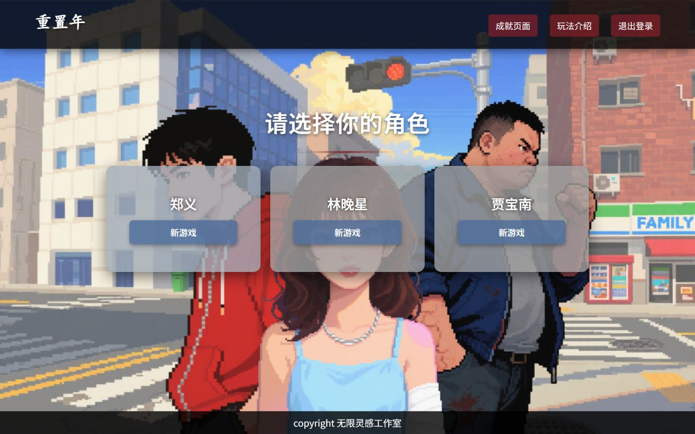
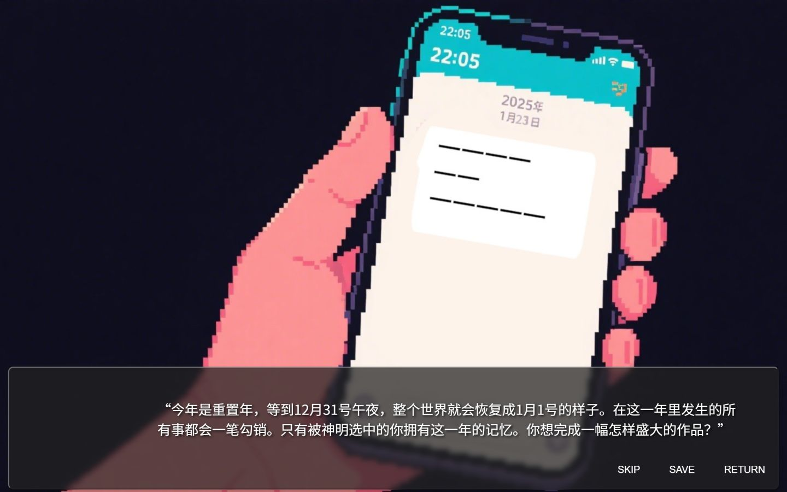
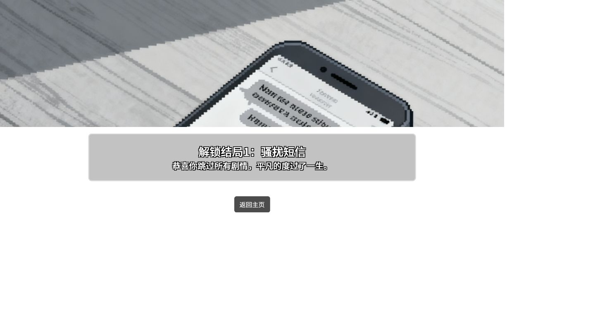

# 重置年

《重置年》是一款多视角、分支叙事的浏览器文字冒险游戏。玩家从郑义、贾宝南和林晚星的视角经历同一段故事，在关键节点做出选择，逐步发现事件背后的真相。游戏由无限灵感组六人合作完成。

故事涉及家庭暴力等严肃主题。项目保留原有美术、页面风格与游戏规则，以静态网页形式运行。

[English](README.en.md) · [技术指南](docs/PROJECT_TECHNICAL_GUIDE.md) · [修复记录](docs/BUGFIX_REPORT.md) · [素材登记](docs/THIRD_PARTY_ASSETS.md)

## 游戏画面

以下为本地浏览器实际运行截图；结局画面来自修复前的原始版本。

| 首页 | 角色菜单 |
| --- | --- |
|  |  |

| 剧情页面 | 结局页面（原始版本） |
| --- | --- |
|  |  |

## 核心玩法

- **多视角剧情**：三条角色路线，12 个剧情结局，选择影响后续章节和结局。
- **解锁路线**：达成郑义结局成就 4、5、6 后开放贾宝南路线；达成贾宝南结局成就 3 后开放林晚星路线。
- **小游戏与成就**：线索连连看和接金币分别关联剧情或小游戏成就；成就页面记录已达成结果。
- **章节存档**：每个本地账户、每个角色各有一个章节书签，可在角色菜单继续。

剧情页面点击对话框推进；`SKIP` 跳过本段，`SAVE` 保存当前章节，`RETURN` 返回角色菜单。继续游戏从已保存页面的开头开始，不恢复到逐句位置。

接金币使用左右方向键或页面提供的移动端控件，接到金币加分，漏接金币或接到炸弹损失生命；达到 50 分获胜。连连看需在 120 秒内消除同类图标，每对加 10 分，连接路径在棋盘内最多转弯两次。两项小游戏的跳过按钮按照当前胜负状态返回相应剧情。

## 运行与构建

需要 Git、Node.js 18 或更高版本，以及支持 JavaScript 和 localStorage 的现代浏览器。本项目没有 npm 第三方依赖。

```bash
git clone https://github.com/dthu7b8a-design/game.git
cd game
npm ci --ignore-scripts
npm start
```

打开 <http://127.0.0.1:4173/>，注册本地账户后登录。也可用其他静态 HTTP 服务器提供项目根目录。Node 及 npm 用于预览、检查和生成静态目录，游戏本身仍为原生多页面网页。

```bash
npm run check       # 检查脚本语法与静态本地引用
npm test            # 运行回归测试
npm run build       # 复制静态生产文件到 dist/
node scripts/serve.mjs dist 4174
```

构建预览地址为 <http://127.0.0.1:4174/>。这些命令在本地 Node.js 24 环境验证；仓库没有已核实的在线体验地址。

**存档说明：**账户、密码、成就和存档存于当前浏览器的 localStorage。密码沿用原有明文结构，请不要使用其他网站的常用密码；清除浏览器站点数据会删除本地记录。当前没有服务端认证或云同步。

## 技术与结构

项目使用 HTML、CSS、JavaScript 和本地 jQuery 3.6.0；团队介绍轮播使用 Swiper 8.1.6。部分字体、图标及音效依赖外部资源。没有 React/Vue、服务端或游戏引擎。

```text
index.html                 首页
注册and登陆/               本地账户、角色菜单、团队介绍
主线/{nanzhu,nvzhu,zhangfu}/  三条剧情线及结局
minigame/                  接金币、连连看
成就界面/                  成就总览与详情
玩法介绍/                  游戏背景与规则
素材/、music/              立绘、背景、音乐与音效
scripts/、tests/           预览、检查、构建与回归测试
docs/                      技术、修复和素材说明
```

各章节由 HTML 页面加载对应剧情数据和 `op1.js`、`op2.js`：前者推进对话、展示分支，后者保存章节与播放背景音乐；页面跳转形成剧情图。结局脚本更新 `userArr` 中的角色成就。更多实现与取舍见[技术指南](docs/PROJECT_TECHNICAL_GUIDE.md)。

## 团队与贡献

这是六人合作项目。现有团队介绍将李石屹列为项目经理、文案与 CIO；其余职责以游戏内团队介绍为准。本次代码修复和测试是在原项目基础上的后续维护，不应归为某一位成员独立完成的全部工作。

## 已知限制与后续工作

- 原有响应式布局在部分窄屏和短屏下仍需进一步实机验证；本次维护保留原 UI。
- 连连看保证至少有一个可用起手，未保证后续任何局面均可解。
- 音频资源体积较大，部分字体和图标依赖网络；尚无完整性能基准。
- 图片、音乐和音效的来源与公开分发依据仍需补齐，详见[素材登记](docs/THIRD_PARTY_ASSETS.md)。
- 浏览器冒烟测试和自动化函数测试不等于所有分支、设备及浏览器均已完整通关。

## 许可证

项目根目录包含 [Mulan PSL v2](LICENSE)。第三方代码和媒体应分别遵守其适用许可；根许可证不能替代素材授权记录。
